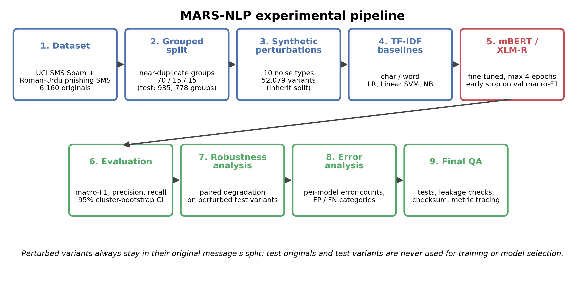
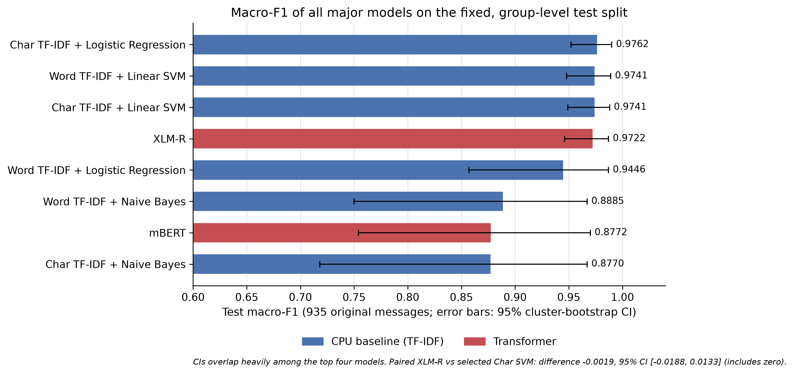
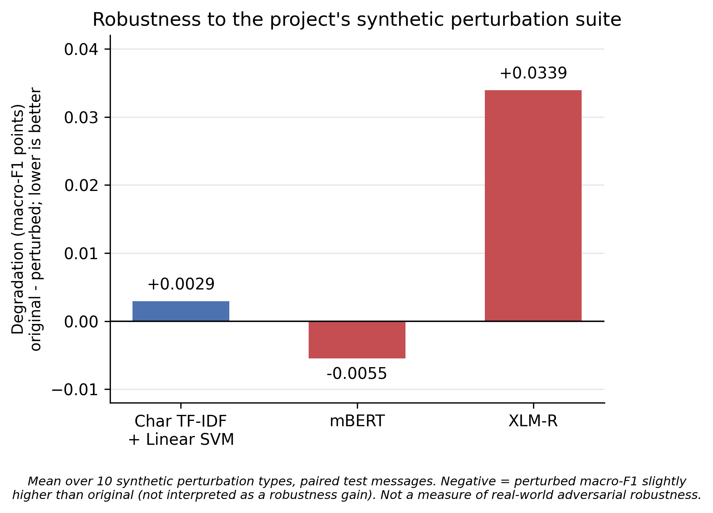

# MARS-NLP: Robust Multilingual Scam Message Classification with Character-Level and Transformer-Based NLP

## Abstract
Scam and spam text messages are written in many languages and orthographies, including Urdu in Latin script (Roman Urdu) mixed with English. We study binary scam message classification on two public SMS corpora (6,160 original messages; English and Roman Urdu/code-switched text), comparing character- and word-level TF-IDF classifiers (logistic regression, linear SVM, naive Bayes) with fine-tuned mBERT and XLM-R. Because the Roman Urdu corpus is highly templated, data are split at the level of near-duplicate groups (4,308/917/935 training/validation/test originals; 778 test groups), and 52,031 synthetic perturbed variants remain in the split of their source message. On the test split, character-level TF-IDF with logistic regression achieved the highest observed macro-F1 (0.9762); character-level TF-IDF with a linear SVM was the validation-selected CPU baseline (0.9741); XLM-R was the best-performing transformer (0.9722; 95% CI [0.946, 0.987]), and mBERT reached 0.8772 ([0.754, 0.970]). The paired macro-F1 difference between XLM-R and the selected SVM was -0.0019 (95% CI [-0.0188, 0.0133]), which provides no evidence of a difference. Under a synthetic perturbation suite, mean macro-F1 degradation was 0.0029 (character SVM), -0.0055 (mBERT) and 0.0339 (XLM-R). Evidence for Roman Urdu/Mixed text rests on five independent test groups, no Urdu-script benchmark is included, and the transformer metrics are owner-verified results of the original GPU run.

## Keywords

scam message detection; SMS spam; Roman Urdu; code-switching; multilingual transformers; character n-grams; robustness to noise; group-aware evaluation

## 1. Introduction

Scam messages delivered by SMS exploit urgency, financial pretexts and impersonation of banks or utilities. In South Asia, users routinely write Urdu in Latin script (Roman Urdu), which has no standardised spelling, and mix it with English within a single message. Such orthographic variability may affect both lexical classifiers, which depend on exact surface forms, and pretrained subword models, whose vocabularies were learned largely from standardised text. Evaluating these systems fairly is further complicated by the structure of the available data: public SMS corpora contain exact and near-duplicate messages, and phishing messages are often generated from a few templates, so a random split can place almost identical messages in training and test sets [9, 10].

This paper compares classical character- and word-level TF-IDF classifiers with fine-tuned multilingual transformers (mBERT [3] and XLM-R [4]) for scam message classification in English, Roman Urdu and code-switched text, under an evaluation protocol designed to respect this structure. The contributions are:

* an audited corpus of 6,160 original messages with a group-level train/validation/test split in which every synthetic perturbed variant stays in the split of its source message;
* a controlled suite of ten synthetic perturbation types and a paired robustness measure, degradation = original macro-F1 - perturbed macro-F1;
* a comparison of six TF-IDF classifiers with mBERT and XLM-R using cluster-bootstrap confidence intervals, including paired comparisons between the best transformer and the validation-selected baseline;
* an explicit account of what the evidence does and does not support, in particular for Roman Urdu/Mixed text (five independent test groups) and for the transformer artifacts that could not be re-verified locally.

## 2. Related Work

SMS spam filtering has been studied extensively; the SMS Spam Collection [1] is a widely used English benchmark and is one of the two corpora used here. The second corpus is a Roman Urdu phishing SMS dataset [2]. Pretrained multilingual encoders - mBERT, the multilingual variant of BERT [3], and XLM-R [4] - can be fine-tuned for classification in many languages; their behaviour on romanised, non-standard orthography is an empirical question that we examine on a small scale. The sensitivity of neural text models to character-level noise has been documented for machine translation [7] and, more generally, for common corruptions [8]; our perturbations follow this idea of random synthetic noise and are not optimised adversarial attacks. Duplicated data and train-test leakage can inflate reported performance [9, 10], which motivates the group-level splitting used here. Uncertainty for clustered observations is estimated with a cluster bootstrap [11, 12]. Implementations rely on scikit-learn [5] and the Hugging Face Transformers library [6]; supplementary explanations for the TF-IDF models use LIME [13].

## 3. Methodology

Figure 3 summarises the experimental pipeline.

*Figure 3. The MARS-NLP experimental pipeline: dataset, grouped split, synthetic perturbations, TF-IDF baselines and transformers, evaluation, robustness analysis, error analysis and quality assurance.*

### 3.1 Dataset

The study uses two public corpora (Table 1). Messages are labelled *Scam* (spam, scam or phishing) or *Legitimate*. Raw text is retained; a cleaned copy applies Unicode NFKC normalisation, HTML-entity decoding, removal of control and zero-width characters and whitespace normalisation, while preserving case, punctuation and spelling variation. Exact duplicates were removed (none had conflicting labels), leaving 6,160 original messages. Language labels (English, Roman Urdu, Mixed/Code-Switched, Unknown) were assigned by a transparent function-word heuristic rather than a trained language-identification model; they are therefore approximate. The test split contains 782 English messages, 142 Mixed/Code-Switched, 7 Roman Urdu and 4 unassigned messages; Roman Urdu and Mixed are analysed together (149 messages). The sources contain no Urdu-script messages, so this study includes no Urdu-script benchmark and makes no claim about Urdu-script text.

*Table 1. Source corpora.*

| Source                      | Language             |   Raw messages |   Originals after cleaning and exact de-duplication |   Near-duplicate groups | License                               |
|:----------------------------|:---------------------|---------------:|----------------------------------------------------:|------------------------:|:--------------------------------------|
| SMS Spam Collection [1]     | English              |           5574 |                                                5160 |                    4951 | CC BY 4.0 (as stated on the UCI page) |
| Roman Urdu phishing SMS [2] | Roman Urdu / English |           1000 |                                                1000 |                      19 | unverified                            |

The Roman Urdu corpus is strongly templated: its 1,000 messages form only 19 near-duplicate groups (largest group: 143 messages), whereas the UCI messages form 4,951 groups.

### 3.2 Data Splitting

Near-duplicate and templated messages were clustered using the cosine similarity of character 3-5-gram TF-IDF vectors of digit-masked, lower-cased text (threshold 0.8, single linkage), giving 4,970 groups over the 6,160 originals. Whole groups were assigned to training, validation and test sets (70/15/15 by message count, stratified by source and label, fixed seed), so no group appears in more than one split (Table 2). The mean maximum cosine similarity between a test message and any training message is 0.33, and no test message has a similarity of 0.80 or more to a training message.

*Table 2. Group-level split of the original messages.*

| Split      |   Original messages |   Scam |   Legitimate |   Groups |
|:-----------|--------------------:|-------:|-------------:|---------:|
| Training   |                4308 |    736 |         3572 |     3411 |
| Validation |                 917 |    156 |          761 |      781 |
| Test       |                 935 |    155 |          780 |      778 |

### 3.3 Synthetic Perturbations

Ten perturbation types (Table 3) were applied to real original messages only, with deterministic seeds; a perturbation is generated only when it is applicable to a message (for example, Roman Urdu spelling variation only for Roman Urdu/Mixed messages). Each variant keeps its source message's label and split, and the 52,031 variants are never treated as independent messages. Variants of test messages (7,943 variants of the 935 test originals) are used only to measure robustness. Variants of training messages were used only in a supplementary set of augmentation-trained baselines; the transformers were trained on the 4,308 training originals only. These perturbations are synthetic and are not equivalent to naturally occurring adversarial messages.

*Table 3. Perturbation types and the number of variants generated.*

| Perturbation type             |   Variants | Description                                                                   |
|:------------------------------|-----------:|:------------------------------------------------------------------------------|
| spelling variation            |       6042 | transposition, doubling or vowel replacement in selected words                |
| character deletion            |       6148 | deletion of about 8% of inner letters (at least one)                          |
| character substitution        |       6148 | keyboard-neighbour or look-alike character substitution (about 8% of letters) |
| word spacing variation        |       6053 | insertion or removal of spaces inside/between words                           |
| punctuation variation         |       6147 | removal, repetition or insertion of punctuation                               |
| casing variation              |       6156 | upper-casing, lower-casing or random casing                                   |
| informal abbreviation         |       4045 | SMS-style abbreviations (e.g. "u", "pls", "msg")                              |
| roman urdu spelling variation |        776 | alternative Roman Urdu spellings (Roman Urdu/Mixed messages only)             |
| code switching                |       4640 | word-level English/Roman Urdu substitution from a small dictionary            |
| minor noise                   |       5876 | one to three random character insertions, deletions or swaps                  |

### 3.4 Character-Level TF-IDF

Character n-grams (2 to 5 characters within word boundaries) with sublinear term frequency, lower-casing, a minimum document frequency of 2 and at most 300,000 features; the vocabulary and inverse document frequencies are fitted on the training split only (32,072 features were retained).

### 3.5 Word-Level TF-IDF

Word unigrams and bigrams with sublinear term frequency, lower-casing, Unicode-aware tokens and a minimum document frequency of 2 (10,274 features retained).

### 3.6 Classical Machine-Learning Models

Each feature set is combined with logistic regression, a linear support vector machine and multinomial naive Bayes (scikit-learn [5]); logistic regression and the SVM use balanced class weights. The regularisation strength (C) or smoothing parameter (alpha) was chosen on validation macro-F1 from small grids (LR: 0.1, 1, 10, 100; SVM: 0.01, 0.1, 1, 10; NB: 0.01, 0.1, 0.5, 1.0). The selected values were C = 100 (character LR), C = 0.1 (character SVM), C = 10 (word LR), C = 0.1 (word SVM) and alpha = 0.01 (both naive Bayes models). The character-level linear SVM had the highest validation macro-F1 (0.9552) and is referred to as the validation-selected CPU baseline.

### 3.7 mBERT

`bert-base-multilingual-cased` [3] with a sequence-classification head, fine-tuned on the 4,308 training originals using the Hugging Face Transformers library [6]. Messages are tokenised with the model's tokenizer, truncated to a maximum length of 128 tokens and padded dynamically with attention masks. Optimisation used the default configuration of the training script (documented in `experiments/configs/transformers.yaml`): AdamW (learning rate 2e-05, weight decay 0.01), linear warm-up over 10% of the steps with linear decay, class-weighted cross-entropy, batch size 32, at most 4 epochs and early stopping on validation macro-F1 (patience 2); the seed was 42. The exact configuration of each run is recorded in its run file, which was not available for re-inspection (Section 8).

### 3.8 XLM-R

`xlm-roberta-base` [4], fine-tuned with the same data, head, optimiser, schedule, loss, batch size, epoch limit and early-stopping rule as mBERT.

## 4. Experimental Setup

**Protocol.** Hyper-parameters (baselines) and the stopping epoch (transformers) were selected on the validation originals; the test split was used once for the final numbers. All reported metrics are computed on the 935 test originals unless stated otherwise (155 Scam and 780 Legitimate messages).

**Metrics.** Accuracy, precision and recall for the Scam class, macro-F1 (the primary metric, because the classes are imbalanced) and weighted-F1. Ninety-five percent confidence intervals for macro-F1 use a percentile cluster bootstrap that resamples near-duplicate groups rather than messages [11, 12] (1,000 resamples for the CPU baselines). Paired comparisons between two models on the same test messages use a paired cluster bootstrap over test groups of the macro-F1 difference.

**Robustness.** For each perturbation type, macro-F1 is computed on the matched original messages and on their perturbed variants; degradation is original macro-F1 minus perturbed macro-F1, so lower values are better and negative values mean that the perturbed score was higher. The model-level value is the mean over the ten perturbation types. This quantifies robustness to the study's synthetic perturbation suite only.

**Error analysis.** Errors are counted per model over the test split's original messages and their perturbed variants (8,878 messages in total); counts are never aggregated across models.

**Hardware and software.** The CPU baselines were trained and timed on one CPU core with scikit-learn 1.8.0 under Python 3.12. The transformers were fine-tuned on a Google Colab NVIDIA Tesla T4 GPU; their latency benchmarks are single-message wall-clock times on that GPU and on the Colab CPU. Latency values from the two environments are not directly comparable and are not edge-device measurements.

## 5. Results

### 5.1 Main Model Comparison

Table 4 and Figure 1 report test performance. Character TF-IDF with logistic regression achieved the highest observed test macro-F1 (0.9762). Character TF-IDF with a linear SVM was the validation-selected CPU baseline, with a test macro-F1 of 0.9741; the word-level SVM obtained the same value. XLM-R was the best-performing transformer with a macro-F1 of 0.9722. The confidence intervals of the four best models overlap almost completely, and the naive Bayes models and mBERT are clearly lower. Five-fold group cross-validation over all originals, a supplementary estimate not used for model selection, gave overall macro-F1 values of 0.982 (character SVM), 0.980 (character LR) and 0.974 (word LR), consistent with the fixed-split ranking among these models.

*Table 4. Test performance on the 935 original test messages (precision and recall refer to the Scam class; CI: 95% cluster bootstrap).*

| Model                             |   Accuracy |   Precision |   Recall |   Macro-F1 |   Weighted-F1 | Macro-F1 95% CI   |
|:----------------------------------|-----------:|------------:|---------:|-----------:|--------------:|:------------------|
| Char TF-IDF + Logistic Regression |     0.9872 |      0.9931 |   0.9290 |     0.9762 |        0.9870 | [0.952, 0.990]    |
| Char TF-IDF + Linear SVM          |     0.9861 |      0.9931 |   0.9226 |     0.9741 |        0.9859 | [0.949, 0.988]    |
| Word TF-IDF + Logistic Regression |     0.9690 |      0.8938 |   0.9226 |     0.9446 |        0.9692 | [0.857, 0.987]    |
| Word TF-IDF + Linear SVM          |     0.9861 |      0.9931 |   0.9226 |     0.9741 |        0.9859 | [0.948, 0.989]    |
| Word TF-IDF + Naive Bayes         |     0.9369 |      0.7927 |   0.8387 |     0.8885 |        0.9376 | [0.750, 0.967]    |
| Char TF-IDF + Naive Bayes         |     0.9283 |      0.7500 |   0.8516 |     0.8770 |        0.9301 | [0.718, 0.967]    |
| mBERT                             |     0.9369 |      0.8750 |   0.7226 |     0.8772 |        0.9344 | [0.754, 0.970]    |
| XLM-R                             |     0.9850 |      0.9862 |   0.9226 |     0.9722 |        0.9848 | [0.946, 0.987]    |

*Figure 1. Test macro-F1 of all models with 95% cluster-bootstrap confidence intervals.*

For Roman Urdu/Mixed messages (149 test messages from five independent groups), the character-level LR and SVM obtained macro-F1 of 1.000 with an interval of [0.500, 1.000]; this interval illustrates that such values are descriptive only. English test macro-F1 was 0.963 (LR) and 0.959 (SVM) on 782 messages. Per-language values for the transformers are not part of the verified summary and are not reported. Zero-shot transfer with TF-IDF models between English and Roman Urdu/Mixed text failed (macro-F1 between 0.38 and 0.48); because language is confounded with source and label semantics, this reflects domain and template differences as much as language.

### 5.2 Transformer Results

Both transformers were fine-tuned on the same 4,308 training originals (Table 5). XLM-R reached its best validation epoch at epoch 4 and mBERT at epoch 2. mBERT had a lower recall for the Scam class (0.7226) than XLM-R (0.9226) and a lower precision (0.8750 versus 0.9862). The transformers are far larger and slower than the TF-IDF models: the character-level SVM has 32,073 classifier weights, a model file of 0.43 MB and a mean single-message CPU latency of 0.84 ms on the CPU baseline machine, compared with 681.3 MB and 1077.0 MB for the transformers.

*Table 5. Transformer training details and computational benchmarks (NVIDIA Tesla T4).*

| Model                                |   Parameters |   Size (MB) |   Best epoch |   Train time (s) |   GPU ms/msg |   CPU ms/msg |   Macro-F1 | 95% CI         |
|:-------------------------------------|-------------:|------------:|-------------:|-----------------:|-------------:|-------------:|-----------:|:---------------|
| mBERT (bert-base-multilingual-cased) |  177,854,978 |    681.3000 |            2 |         287.5000 |       9.5200 |     125.6500 |     0.8772 | [0.754, 0.970] |
| XLM-RoBERTa (xlm-roberta-base)       |  278,045,186 |   1077.0000 |            4 |         295.6000 |      10.2500 |     117.4800 |     0.9722 | [0.946, 0.987] |

### 5.3 Statistical Comparison

Table 6 reports paired macro-F1 differences on the test split (cluster bootstrap over test groups). The difference between XLM-R and the selected character SVM is -0.001915 with a 95% confidence interval of [-0.018834, 0.013255], which includes zero; there is therefore no evidence of a statistically significant difference between them, and no superiority of XLM-R over the selected SVM is claimed. XLM-R exceeded mBERT by 0.095037 (95% CI [0.001722, 0.223619]); the interval excludes zero, but it is wide and its lower bound is close to zero, so the evidence is modest. On English test messages only, the difference between XLM-R and mBERT was 0.008583 (95% CI [-0.006933, 0.025362]), which includes zero; no English-only superiority is claimed.

*Table 6. Paired macro-F1 differences (A minus B) with 95% cluster-bootstrap intervals.*

| Comparison                                 |   Difference (A - B) | 95% CI                | CI includes zero   |
|:-------------------------------------------|---------------------:|:----------------------|:-------------------|
| XLM-R vs selected Char TF-IDF + Linear SVM |            -0.001915 | [-0.018834, 0.013255] | yes                |
| XLM-R vs mBERT                             |             0.095037 | [0.001722, 0.223619]  | no                 |
| XLM-R vs mBERT (English-only)              |             0.008583 | [-0.006933, 0.025362] | yes                |

### 5.4 Robustness Evaluation

Table 7 and Figure 2 give the mean degradation under the ten synthetic perturbation types. The character-level SVM degraded by 0.0029, XLM-R by 0.0339, and mBERT by -0.0055; the slightly negative value for mBERT means that its perturbed macro-F1 was marginally higher than its original macro-F1 and is not interpreted as a robustness gain. XLM-R therefore showed the largest degradation of the three models, and its absolute drop is small. Table 8 gives the per-type results for the selected SVM: the only type whose paired interval excludes zero is character substitution (0.0145); casing variation has zero effect by construction because the vectoriser lower-cases text, and the Roman Urdu spelling variation estimate rests on five groups. Per-type results for the transformers are not part of the verified summary. All of these values describe robustness to the study's synthetic perturbation suite, not real-world adversarial robustness.

*Table 7. Mean degradation over the ten perturbation types (original macro-F1 - perturbed macro-F1; lower is better).*

| Model                    |   Degradation |
|:-------------------------|--------------:|
| Char TF-IDF + Linear SVM |        0.0029 |
| mBERT                    |       -0.0055 |
| XLM-R                    |        0.0339 |

*Figure 2. Robustness degradation under the synthetic perturbation suite.*

*Table 8. Per-type degradation for the validation-selected character-level SVM (paired test messages).*

| Perturbation type             |   Paired messages |   Groups |   Degradation | 95% CI            |
|:------------------------------|------------------:|---------:|--------------:|:------------------|
| spelling variation            |               913 |      757 |        0.0021 | [0.0000, 0.0079]  |
| character deletion            |               935 |      778 |        0.0041 | [-0.0079, 0.0143] |
| character substitution        |               935 |      778 |        0.0145 | [0.0053, 0.0298]  |
| word spacing variation        |               923 |      767 |        0.0042 | [0.0000, 0.0125]  |
| punctuation variation         |               932 |      775 |        0.0022 | [-0.0070, 0.0126] |
| casing variation              |               935 |      778 |        0.0000 | [0.0000, 0.0000]  |
| informal abbreviation         |               632 |      527 |        0.0000 | [-0.0080, 0.0079] |
| roman urdu spelling variation |               137 |        5 |        0.0000 | [0.0000, 0.0000]  |
| code switching                |               700 |      568 |        0.0022 | [-0.0060, 0.0121] |
| minor noise                   |               901 |      744 |        0.0002 | [-0.0061, 0.0074] |

### 5.5 Error Analysis

Table 9 lists the number of misclassifications per model over the test originals and their perturbed variants (8,878 messages). On the 935 test originals, the character-level logistic regression made 12 errors (11 false negatives and 1 false positive). The word-level logistic regression made 29 errors, and all 17 of its false positives were legitimate Roman Urdu/Mixed messages from one templated group (utility-bill notices; 17 messages), which illustrates how a single template can dominate errors on the small Roman Urdu/Mixed portion of the test set. Models marked "aug-trained" are supplementary baselines trained on the training originals plus their perturbed variants. False-positive and false-negative splits for the transformers require their raw prediction files and are not reported; counts are never summed across models.

*Table 9. Errors per model over test originals and perturbed variants.*

| Model                                           | ID           |   Errors |
|:------------------------------------------------|:-------------|---------:|
| Word TF-IDF + Logistic Regression               | word_lr      |      291 |
| Word TF-IDF + Linear SVM                        | word_svm     |      177 |
| Word TF-IDF + Naive Bayes                       | word_nb      |      550 |
| Char TF-IDF + Logistic Regression               | char_lr      |      141 |
| Char TF-IDF + Linear SVM                        | char_svm     |      142 |
| Char TF-IDF + Naive Bayes                       | char_nb      |      533 |
| Word TF-IDF + Logistic Regression (aug-trained) | word_lr_aug  |      509 |
| Word TF-IDF + Linear SVM (aug-trained)          | word_svm_aug |      511 |
| Word TF-IDF + Naive Bayes (aug-trained)         | word_nb_aug  |      359 |
| Char TF-IDF + Logistic Regression (aug-trained) | char_lr_aug  |      159 |
| Char TF-IDF + Linear SVM (aug-trained)          | char_svm_aug |      146 |
| Char TF-IDF + Naive Bayes (aug-trained)         | char_nb_aug  |      423 |
| mBERT                                           | mbert        |      614 |
| XLM-R                                           | xlmr         |      264 |

## 6. Discussion

Under group-aware evaluation, simple character-level TF-IDF classifiers are strong and inexpensive baselines on these corpora: the best of them reached a macro-F1 of 0.9762, and the validation-selected SVM 0.9741. XLM-R (0.9722) was competitive, but the paired interval against the selected SVM includes zero, so the data do not support a ranking among the top models; mBERT (0.8772) was lower, mainly through recall. We did not investigate why mBERT and XLM-R differ, and the modest evidence for the XLM-R versus mBERT difference calls for repeated runs.

The lower macro-F1 of the word-level logistic regression relative to the character-level models on the fixed split is largely attributable to a single templated group of legitimate messages. Because the Roman Urdu/Mixed portion of the test set contains only five independent groups, this should not be read as evidence that character n-grams are generally superior; the cross-validated difference is smaller. Likewise, the Roman Urdu/Mixed scores of the baselines are descriptive.

The robustness comparison favours the character-level SVM on this suite (smallest positive degradation, with a precisely estimated per-type profile), whereas XLM-R had the largest degradation. A possible contributing factor, which we did not test, is the interaction between subword tokenisation and character-level noise. The suite consists of random synthetic edits, and the results do not indicate how the models would behave against messages crafted by an adversary or against naturally occurring spelling variation.

Computationally, the transformers require hundreds of megabytes and, on a CPU, on the order of one hundred milliseconds per message in the Colab environment, compared with under one millisecond for the TF-IDF models on a single core; these figures come from different machines and are indicative only. Whether the additional cost is justified depends on the deployment setting, which this study does not address.

## 7. Limitations

* The dataset is domain-specific: English SMS marketing spam and templated Roman Urdu phishing messages; results may not transfer to other message types, regions or time periods.
* The perturbations are synthetic. They are not equivalent to naturally occurring perturbations or adversarial messages, so robustness findings are limited to the study's perturbation suite.
* Evidence for Roman Urdu/Mixed text is limited, and it comes from only five independent test groups; point estimates and intervals for this subset are descriptive.
* There is no comprehensive Urdu-script benchmark: the sources contain no Urdu-script messages and Urdu script is not evaluated.
* Multi-seed variance was not estimated for every model; each transformer was trained once.
* The hyper-parameter search was not exhaustive (small grids for the baselines; fixed settings for the transformers).
* Computational measurements depend on the Tesla T4 and the software environment, and CPU and GPU benchmarks were taken on different machines.
* SHAP and Integrated Gradients analyses were not performed, and no interpretability analysis of the transformers was carried out.
* The raw transformer artifacts from the original Colab run were unavailable in the final local release workspace; the transformer metrics are therefore owner-verified results that have not been independently reproduced locally (see Section 8).
* Language labels are heuristic, source and language are partly confounded, and the positive class differs in meaning between corpora (unsolicited marketing versus phishing). The Zenodo license is unverified.
* AI-assisted workflow limitation: ChatGPT (OpenAI) and Claude (Anthropic) supported parts of coding, debugging, code review, and manuscript/documentation editing. Such tools can introduce errors and were not treated as independent validators; the author performed hands-on implementation, ran and reviewed experiments, and remains responsible for the work.

## 8. Reproducibility

*Code and data.* The repository contains the data-building, splitting, validation, training, evaluation, robustness and reporting code. Third-party data are not redistributed: the processed corpus is rebuilt deterministically from the original UCI and Zenodo files and verified against a SHA-256 checksum (`8ee14e8791ac55e3db9e6bee6ce0535052b040d172ebbc4a5b9320734479a59c`) and split fingerprints (training cb20c5190816..., validation f155bbf81741..., test 727092f30d11...). Every training run verifies the checksum and aborts on a mismatch or on any group overlap between splits.

*Quality assurance.* The original Colab execution reported **47 PASS, 0 FAIL, 0 PENDING, 0 SKIP**. The final local release-package QA reports **50 PASS, 0 FAIL, 3 PENDING, 0 SKIP**. The three pending checks arise only because the raw Colab transformer artifacts are absent from the final local workspace:

1. `transformer mbert: raw result files` - missing raw mBERT artifacts (`transformer_mbert.json`, predictions, subsets, robustness CSV, checkpoint)
2. `transformer xlmr: raw result files` - missing raw XLM-R artifacts (`transformer_xlmr.json`, predictions, subsets, robustness CSV, checkpoint)
3. `transformers: no-N/A check on raw executed runs` - no-N/A verification for executed transformer runs: it can only run on the raw run files

*Status of the transformer results.* The transformer metrics were obtained from the verified Colab execution and are treated as owner-verified results. Raw transformer artifacts (run files, predictions, robustness files, checkpoints and the CUDA/PyTorch environment record) were not available for independent local verification; they were neither reconstructed nor replaced, and the three pending checks are not failures. The CPU-baseline results, in contrast, were recomputed locally from their raw prediction files. The training settings quoted in Section 3.7 are the documented defaults of the training command. Complete raw-artifact reproducibility is therefore not claimed for mBERT and XLM-R. If the raw files are supplied, `python -m src.qa_check` recomputes and checks every transformer metric.

## 9. Conclusion

On two public SMS corpora and under a group-aware protocol, character-level TF-IDF classifiers were strong baselines: character TF-IDF with logistic regression achieved the highest observed test macro-F1 (0.9762), and the validation-selected character SVM reached 0.9741. XLM-R was the best-performing transformer (0.9722) but did not detectably differ from the selected SVM, and mBERT was lower (0.8772). Under the synthetic perturbation suite the SVM degraded least, while the evidence for Roman Urdu/Mixed text, limited to five independent test groups, remains descriptive. The transformer metrics are owner-verified results of the original GPU run. Future work includes a larger and more diverse Roman Urdu and Urdu-script corpus, repeated transformer runs, naturally occurring and adversarial perturbations, and interpretability analysis of the transformers.

## 10. AI-Assisted Tools Disclosure

AI-assisted tools, including ChatGPT (OpenAI) and Claude (Anthropic), were used as aids during parts of the coding, debugging, code review, and manuscript/documentation editing workflow. The author also performed hands-on implementation and repository work, ran and inspected experiments including the Google Colab GPU workflow, reviewed outputs, and made the research and reporting decisions. AI tools were used as assistants rather than as authors or independent validators; the author takes responsibility for the code, analysis, interpretation, and final manuscript. The transformer metrics remain identified as owner-verified because their original raw run artifacts are not present in this repository snapshot.

## 11. References

1. Almeida, T. A., Gomez Hidalgo, J. M., & Yamakami, A. (2011). Contributions to the study of SMS spam filtering: new collection and results. *Proceedings of the 11th ACM Symposium on Document Engineering (DocEng '11)*.
2. Siddiq, G. *Roman Urdu Phishing SMS Dataset for Smishing Detection Research*. Zenodo. DOI 10.5281/zenodo.21810885.
3. Devlin, J., Chang, M.-W., Lee, K., & Toutanova, K. (2019). BERT: Pre-training of deep bidirectional transformers for language understanding. *Proceedings of NAACL-HLT 2019*.
4. Conneau, A., Khandelwal, K., Goyal, N., et al. (2020). Unsupervised cross-lingual representation learning at scale. *Proceedings of ACL 2020*.
5. Pedregosa, F., Varoquaux, G., Gramfort, A., et al. (2011). Scikit-learn: Machine learning in Python. *Journal of Machine Learning Research*, 12, 2825-2830.
6. Wolf, T., Debut, L., Sanh, V., et al. (2020). Transformers: State-of-the-art natural language processing. *Proceedings of EMNLP 2020: System Demonstrations*.
7. Belinkov, Y., & Bisk, Y. (2018). Synthetic and natural noise both break neural machine translation. *Proceedings of ICLR 2018*.
8. Hendrycks, D., & Dietterich, T. (2019). Benchmarking neural network robustness to common corruptions and perturbations. *Proceedings of ICLR 2019*.
9. Lee, K., Ippolito, D., Nystrom, A., et al. (2022). Deduplicating training data makes language models better. *Proceedings of ACL 2022*.
10. Elangovan, A., He, J., & Verspoor, K. (2021). Memorization vs. generalization: Quantifying data leakage in NLP performance evaluation. *Proceedings of EACL 2021*.
11. Field, C. A., & Welsh, A. H. (2007). Bootstrapping clustered data. *Journal of the Royal Statistical Society: Series B*, 69(3), 369-390.
12. Efron, B., & Tibshirani, R. J. (1993). *An Introduction to the Bootstrap*. Chapman & Hall.
13. Ribeiro, M. T., Singh, S., & Guestrin, C. (2016). "Why should I trust you?": Explaining the predictions of any classifier. *Proceedings of KDD 2016*.
